<!-- Profile README for github.com/samikaartinen-dot -->

  

### Hi, I'm Sami 👋

A technology teacher from Finland who builds things where **wood, lasers, electronics and code** meet.
Right now I'm building **MANEK**, a screen-free coding game for kids, and learning Python on my way to becoming an **AI developer**.

<!-- TODO: add LinkedIn link here when ready, e.g. 💬 [LinkedIn](https://www.linkedin.com/in/YOUR-ID) -->

---

### 🔧 What I'm building

  
  
  

---

<b>🛠️ How this workshop works</b>

 

The picture above is **drawn by a Python script** ([`generator/`](generator/)) and redrawn every two hours by a GitHub Action.

| In the workshop | Comes from |
|---|---|
| MANEK LED board (8×8) | my GitHub contributions for the last 64 days |
| Steam from the coffee mug, multimeter | today's commits |
| Stack of laser-cut pieces | this week's commits |
| Manek the hedgehog | walks when I code – sleeps if I haven't committed in 3 days |
| Laser engraving | changes with the repo I updated last |
| Window | real weather and daylight in Finland |
| Flag, cake, Christmas tree, vappu balloons… | Finnish flag days and holidays |
| Shelf boxes, trophies, progress bars, project cards | my languages, milestones and [`config.yml`](config.yml) |
| Nixie tubes | visitors, counted by the badge at the bottom of this page |

  

